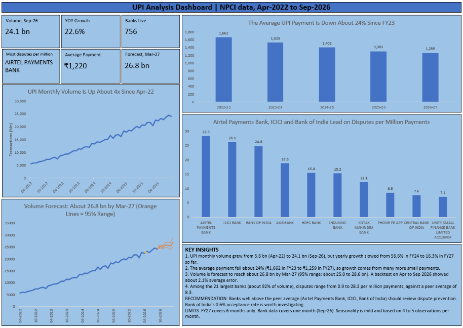

# UPI Transaction Analysis | Excel + Power Query

An end-to-end analysis of India's UPI payments using official NPCI data: growth, average payment size, seasonality, a back-tested forecast, and a bank-level dispute (chargeback) ranking, all summarised in one Excel dashboard.

## Business questions

1. How fast is UPI growing, and is the growth slowing?
2. Is the average payment getting bigger or smaller?
3. Does volume follow a calendar pattern once month length and trend are removed?
4. Where is monthly volume headed over the next six months, and how reliable is that forecast?
5. Which large banks generate the most payment disputes relative to their size?

## Data

Both datasets come directly from NPCI (npci.org.in, Statistics section).

| Dataset | Coverage |
|---|---|
| UPI Product Statistics (monthly) | Apr 2022 to Sep 2026, 54 months, from five financial-year files |
| UPI Ecosystem Statistics, Chargeback | Sep 2026, 307 beneficiary-bank rows (280 parent banks after grouping) |

## Tools and methods

- **Power Query**: combined the five yearly files from a folder into one table, cleaned mixed text and date formats, stripped Indian-style commas, and set data types. Adding a new month's file and clicking Refresh updates the table.
- **Excel tables and formulas**: financial year, days in month, daily average volume, average ticket size, month-on-month and year-on-year growth.
- **PivotTables and calculated fields**:
  - Yearly growth, using average monthly volume so a partial year compares fairly.
  - Average ticket size, calculated as total value divided by total volume.
  - Seasonality, using each calendar month's average daily growth over the previous month.
  - Bank-level chargebacks per million transactions and accepted share, after grouping each bank's handles under one parent bank and excluding banks below 100 million transactions.
- **Excel Forecast Sheet (exponential smoothing)**: six-month forecast, back-tested before use.
- **Dashboard**: KPI cards, four charts, and an insights box.

## Key findings

1. **Growth is large but slowing.** Monthly volume rose from 5.6 bn (Apr-22) to 24.1 bn (Sep-26). Average monthly volume grew 56.6% in FY24, 41.7% in FY25, 30.0% in FY26, and 16.3% in FY27 (six months only, so provisional). Banks live on UPI rose from 316 to 756.
2. **The average payment is shrinking.** It fell from about ₹1,662 in FY23 to about ₹1,259 in FY27 so far (roughly 24% lower), while volume nearly tripled. Growth comes from many more small payments, not bigger ones.
3. **Seasonality is mild.** Average daily volume grows about 2.8% per month overall. February (4.7%), October (4.4%), and August (4.2%) grew faster than that, while November (0.9%) and January (1.5%) grew slower. Each month rests on only four or five observations.
4. **The forecast was tested.** Using data up to Mar-26 to predict Apr-26 to Sep-26, the average error was about 2.1%, all six actual values fell inside the 95% interval, and the forecast underestimated actual volume in every month. The final forecast (all 54 months) puts volume at about 26.8 bn by Mar-27, with a 95% range of roughly 25.0 to 28.6 bn.
5. **Dispute rates vary widely among large banks.** For the 21 banks handling at least 100 million transactions (about 92% of volume), chargebacks per million payments range from 0.9 (UCO Bank) to 28.3 (Airtel Payments Bank), against a peer average of 8.3. The highest were Airtel Payments Bank (28.3), ICICI Bank (26.1), Bank of India (24.8), Axis Bank (18.8), and HDFC Bank (15.4).
6. **Accepted share differs even more.** Bank of India accepted only 0.6% of its disputes (50 of 7,748), while ICICI Bank accepted 39.7%. This pattern is worth investigating with more months of data.

## Recommendation

Banks well above the peer average on disputes per million (Airtel Payments Bank, ICICI Bank, Bank of India) should review their dispute-prevention processes. Bank of India's very low acceptance rate deserves a closer look, to see whether disputes are being rightly contested or declined by default.

## Limitations

- FY 2026-27 contains six months only, so its growth figure is provisional.
- Bank data covers a single month (Sep-26), so results describe that month, not a consistent trend.
- Banks are grouped by name prefix. Some entries are payment-app or processor handles, so the grouping is a simplification.
- A dispute rate is not a quality score. The mix of merchants a bank serves can affect it.
- The forecast is a statistical extrapolation, and the back-test covers only six months.
- Seasonality is mild and based on only four to five observations per month.

## Workbook guide (`UPI_Analysis.xlsx`)

| Sheet | Contents |
|---|---|
| `Dashboard` | Final one-page dashboard |
| `Dashboard_Data` | Helper ranges that feed the dashboard cards and charts |
| `UPI_Product_Files` | Cleaned monthly table (`tbl_UPI`) with calculated columns |
| `Pivot_Analysis` | Growth by financial year, average ticket size, and seasonality PivotTables |
| `Bank_Data` | Cleaned chargeback table with parent-bank grouping |
| `Bank_Risk` | Bank-level chargebacks per million and accepted share |
| `Forecast_Data` | Date and volume series used for forecasting |
| `Backtest_12`, `Backtest_Auto` | Back-tests on Apr-26 to Sep-26, with error and interval checks |
| `Forecast_Final`, `Forecast_Alt` | Final forecast (12-month seasonality) and an alternative |

## Author

Abhishek Tripathi | https://www.linkedin.com/in/abhishek-tripathi-431b20223/
